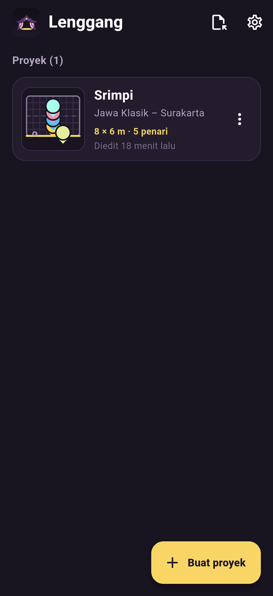
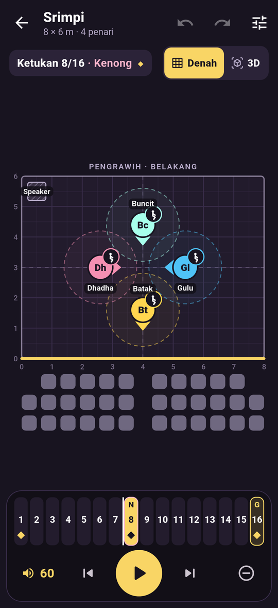
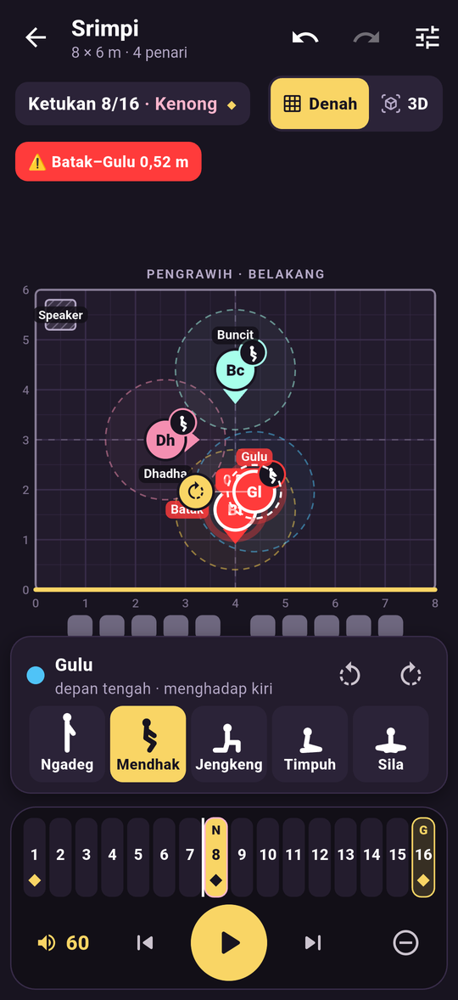
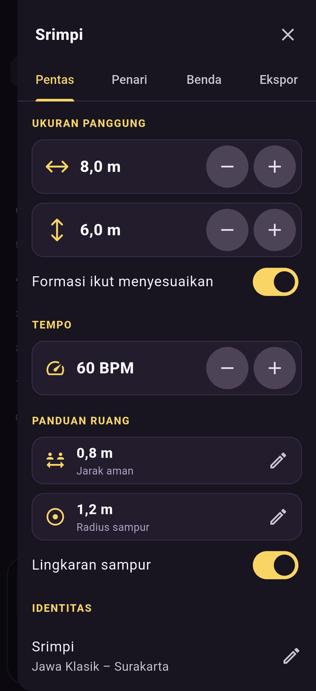
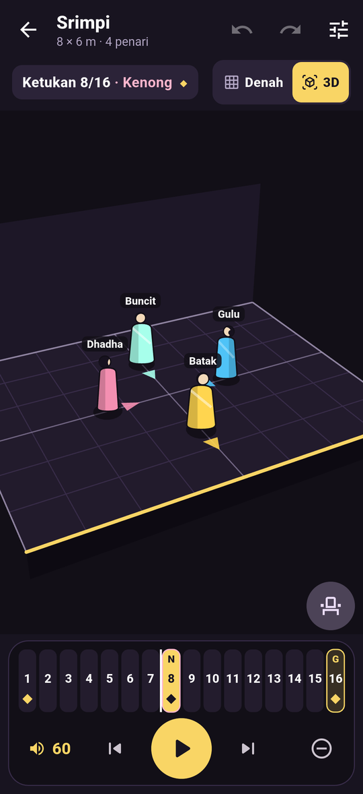
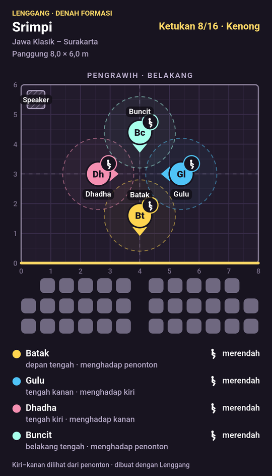

# Lenggang

**Lenggang** adalah aplikasi mobile (Flutter, Android) untuk **tata panggung
(stage blocking) dan partitur spasial tari tradisi Nusantara**. Koreografer
menyusun formasi penari di atas denah panggung berskala meter, mengikatnya ke
ketukan siklus gongan gamelan, memutar perpindahannya, dan langsung melihat
bila dua penari terlalu dekat.

Aplikasi berjalan **sepenuhnya luring** (offline-first): tidak ada akun,
server, maupun data yang dikirim ke luar perangkat.

Dibuat oleh **Tim Hot Nerdy** (Universitas Brawijaya) untuk BUDAYA GO! 2026
kategori Inovasi Digital.

## Tangkapan layar

| Beranda | Denah (ketukan 8, kenong) | Peringatan jarak |
| :---: | :---: | :---: |
|  |  |  |

| Laci proyek | Tampilan 3D |
| :---: | :---: |
|  |  |

Contoh lembar denah hasil ekspor PNG:



## Status fitur

### Sudah berfungsi (versi 1.0.0)

| Fitur | Keterangan |
| :--- | :--- |
| Proyek | Beranda daftar proyek; buat, buka, hapus. Metadata: nama tarian, gaya tradisi, penata tari. Tersimpan otomatis di perangkat (Hive). |
| Kanvas panggung berskala | Panjang × lebar panggung dalam meter (2–30 m), grid 1 m (dan 0,5 m bila cukup besar), label meter, sisi penonton digambar sebagai deretan kursi berskala (0,5 m per kursi) dan sisi belakang berlabel pengrawih. Digambar dengan `CustomPainter`. |
| Formasi ikut ukuran panggung | Saat ukuran panggung diubah, pola lantai dan jarak antarpenari di semua ketukan ikut merenggang atau merapat sebanding — formasi dari sanggar kecil langsung mengisi panggung besar. Ada pilihan "jarak tetap". |
| Penari | Preset rujukan **Srimpi 4 penari** — Batak, Gulu, Dhadha, Buncit — dengan warna kontras tinggi. Tambah/hapus penari generik (maksimal 12), ubah peran, nama, dan warna. |
| Geser penari | Area sentuh 56 dp per penari; posisi tidak melompat saat mulai digeser; koordinat (meter) tampil selama digeser. |
| Arah hadap | Panah per penari; putar lewat tombol ±45° atau tarik tuas putar di kanvas (snap 45°). |
| Level pose | 5 pose per penari per ketukan: ngadeg 1,6 m · mendhak 1,3 m · jengkeng 1,0 m · timpuh 0,8 m · sila 0,8 m. Tiap pose punya gambar sosok kecil di pemilih pose dan di titik penari; tinggi kepala bisa diubah di Pengaturan. |
| Linimasa Ketawang 16 ketukan | Formasi tersimpan per ketukan (◆), penanda **kenong di ketukan 8** dan **gong ageng di ketukan 16**, tempo 10–200 BPM, putar/jeda, scrub, lompat per ketukan. |
| Animasi perpindahan | Interpolasi posisi dan arah hadap antar-formasi; semua penari berangkat dan tiba bersamaan ("berangkat bersama, sampai bersama"). |
| Bunyi sintetis | Ketukan, kenong, dan gong dibangkitkan sendiri (sinus + envelope) oleh `tool/generate_sounds.dart`; bisa dimatikan. |
| Deteksi jarak | Saat mengedit maupun saat animasi: jarak antarpusat dua penari < **0,8 m** → kedua titik merah, garis penghubung berlabel jarak, dan peringatan di atas denah (hanya muncul saat ada masalah). Ambang bisa diubah. |
| Benda panggung & properti tari | Speaker, monitor, tiang, gamelan, atau benda lain dipetakan sebagai **area terhalang**; penari yang masuk area itu memicu peringatan. Properti tari diletakkan sebagai penanda. Bisa digeser dan dihapus langsung di denah, diubah nama dan ukurannya, dan ikut tersimpan di `.lenggang`. |
| Radius sampur | Lingkaran panduan **1,2 m** di sekitar tiap penari; bisa dimatikan dan nilainya bisa diubah. |
| Tampilan 3D | Tombol **Denah / 3D** di editor. Proyeksi perspektif buatan sendiri di `CustomPainter` (tanpa pustaka 3D): kursi penonton bisa digeser kiri–kanan, maju–mundur, dan naik hingga 12 m (seret layar, cubit dua jari untuk jarak, atau pakai slider yang bisa disembunyikan); figur penari setinggi posenya, benda panggung sebagai kotak, urutan kedalaman, ikut animasi linimasa, dan penanda penari yang kepalanya terhalang penari lain. Figur masih sederhana (tahap awal). |
| Ekspor PNG | Lembar denah untuk penari (kanvas ditangkap lewat `RepaintBoundary`, resolusi 3×): letak, arah hadap, dan pose ditulis dengan kata — bukan koordinat. Simpan ke berkas atau bagikan. |
| Ekspor/impor `.lenggang` | Berkas JSON terbuka; simpan, bagikan, dan impor kembali menjadi proyek yang identik (diuji dengan unit test round-trip). |
| Urungkan / Ulangi | Hingga 50 langkah terakhir per sesi edit. |

### Rencana lanjutan (belum ada di versi ini)

- Figur 3D yang lebih rinci dan panggung bertingkat.
- Benda dan properti yang berpindah per ketukan.
- Siklus Ladrang 32 ketukan dan siklus irama daerah lain.
- Pemeriksa pakem/kaidah tradisi (hierarki peran, arah hadap saat gong).
- Lembar cetak A4/PDF berskala.
- Sinkronisasi dengan rekaman audio iringan.
- Sinkronisasi awan dan akun pengguna.
- Rilis iOS (kode Flutter lintas platform, tetapi baru diuji di Android).

## Memasang APK

1. Unduh `lenggang-v1.0.0.apk` dari halaman **Releases** repositori ini.
2. Buka berkas di ponsel Android (Android 7.0 / API 24 ke atas).
3. Bila diminta, izinkan "Pasang aplikasi dari sumber ini".
4. Buka **Lenggang** → **Buat proyek** → pilih *Srimpi · 4 penari*.

APK ditandatangani dengan kunci debug (cukup untuk pengujian, belum untuk
Play Store).

## Cara pakai singkat

1. **Buat proyek**: isi nama tarian, gaya tradisi, penata tari, dan ukuran
   panggung.
2. **Susun formasi**: ketuk penari untuk memilih, geser untuk memindah, tarik
   tuas kuning untuk memutar arah hadap, pilih pose di panel bawah.
3. **Pindah ketukan**: ketuk angka di linimasa. Mengubah formasi di ketukan
   yang belum punya formasi otomatis menyimpannya di sana (◆).
4. **Putar**: tombol ▶ menjalankan satu gongan berulang; titik merah berarti
   dua penari terlalu dekat atau penari masuk area benda panggung.
5. **Lihat dari kursi penonton**: tombol **3D** di kanan atas, sebaris
   dengan keterangan ketukan; seret layar untuk pindah kursi.
6. **Ganti panggung**: ikon pengaturan kanan atas → **Pentas** → ubah ukuran;
   formasi ikut menyesuaikan.
7. **Benda panggung**: tab **Benda** → tambah speaker, tiang, atau properti.
   Di denah, ketuk benda untuk menggeser atau menghapusnya.
8. **Ekspor**: tab **Ekspor**.

## Membangun dari sumber

Prasyarat: Flutter 3.50 (Dart 3.14) dan Android SDK.

```bash
flutter pub get
flutter analyze
flutter test
flutter build apk --release
# hasil: build/app/outputs/flutter-apk/app-release.apk
```

Membangkitkan ulang bunyi sintetis (opsional, hasilnya sudah ada di
`assets/audio/`):

```bash
dart tool/generate_sounds.dart
```

### Arsitektur

| Lapisan | Teknologi | Lokasi |
| :--- | :--- | :--- |
| State | Riverpod (`Notifier`) | `lib/state/` |
| Kanvas | `CustomPainter`, digambar ulang langsung oleh playhead (`ValueNotifier`) tanpa membangun ulang widget | `lib/ui/stage/` |
| Linimasa & interpolasi | Dart murni, teruji unit | `lib/logic/` |
| Penyimpanan lokal | Hive (`hive_ce`) — tiap proyek disimpan sebagai JSON `.lenggang` | `lib/services/storage.dart` |
| Format berkas | JSON | `lib/services/lenggang_format.dart` |
| Ekspor gambar | `RepaintBoundary.toImage` | `lib/services/export_service.dart` |
| Bunyi | Sintesis aditif → WAV | `lib/services/synth.dart` |
| Tampilan 3D | Proyeksi perspektif sendiri + depth sorting | `lib/ui/sightline/` |

## Format berkas `.lenggang`

Berkas teks JSON (UTF-8) berekstensi `.lenggang`. Skema versi 1:

```json
{
  "format": "lenggang",
  "schemaVersion": 1,
  "id": "mhy2k1abc",
  "metadata": {
    "title": "Srimpi",
    "tradition": "Jawa Klasik – Surakarta",
    "choreographer": "Nama Penata Tari",
    "createdAt": "2026-11-25T15:04:05.000Z",
    "updatedAt": "2026-11-25T16:20:00.000Z"
  },
  "stage": { "unit": "m", "width": 8.0, "depth": 6.0, "origin": "…" },
  "rhythm": {
    "cycle": "ketawang16",
    "name": "Ketawang",
    "beatsPerCycle": 16,
    "kenong": [8],
    "gong": [16],
    "bpm": 60
  },
  "dancers": [
    { "id": "batak", "role": "Batak", "name": "", "color": "#FFD54F" }
  ],
  "objects": [
    { "id": "o1", "type": "obstacle", "label": "Speaker",
      "x": 0.5, "y": 5.5, "width": 0.6, "depth": 0.6 }
  ],
  "keyframes": [
    {
      "beat": 1,
      "positions": [
        { "dancer": "batak", "x": 4.0, "y": 1.5, "facing": 0.0, "pose": "jengkeng" }
      ]
    }
  ]
}
```

| Isian | Arti |
| :--- | :--- |
| `stage.width` / `stage.depth` | Panjang (kiri–kanan) dan lebar (depan–belakang) panggung, meter. |
| `x`, `y` | Posisi pusat penari dalam meter. Titik asal di sudut **depan-kiri** panggung dilihat dari penonton; `x` bertambah ke kanan, `y` bertambah ke belakang. |
| `facing` | Arah hadap dalam derajat: `0` menghadap penonton, `90` ke kanan (dilihat dari penonton), `180` membelakangi penonton, `270` ke kiri. |
| `pose` | `ngadeg`, `mendhak`, `jengkeng`, `timpuh`, atau `sila`. |
| `objects` | Opsional. Benda panggung (`type: "obstacle"`, area terhalang) dan properti tari (`type: "prop"`): pusat `x`,`y` serta ukuran `width` × `depth` dalam meter. |
| `beat` | Ketukan 1–16 dalam satu gongan. Di antara dua keyframe, posisi dan arah hadap diinterpolasi linear. |
| `rhythm.cycle` | Tipe siklus; versi ini mengenal `ketawang16`. |

Aplikasi menolak berkas dengan `schemaVersion` lebih baru daripada yang
didukungnya, dan menampilkan alasan bila berkas tidak valid.

## Lisensi

Hak cipta © 2026 Tim Hot Nerdy, seluruh hak dilindungi. Kode sumber boleh
dibaca dan dijalankan untuk penilaian; penggunaan lain memerlukan izin tertulis.
Spesifikasi format berkas `.lenggang` di atas bersifat terbuka. Lihat
[LICENSE](LICENSE).
